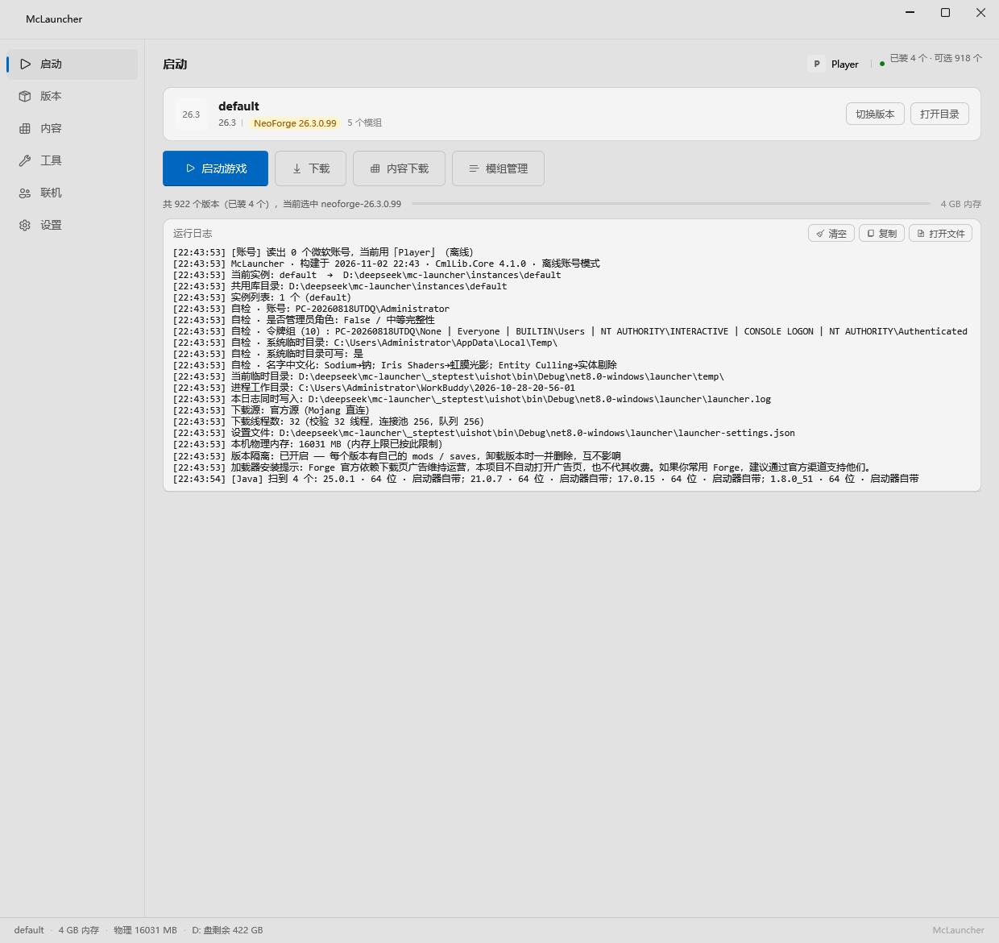
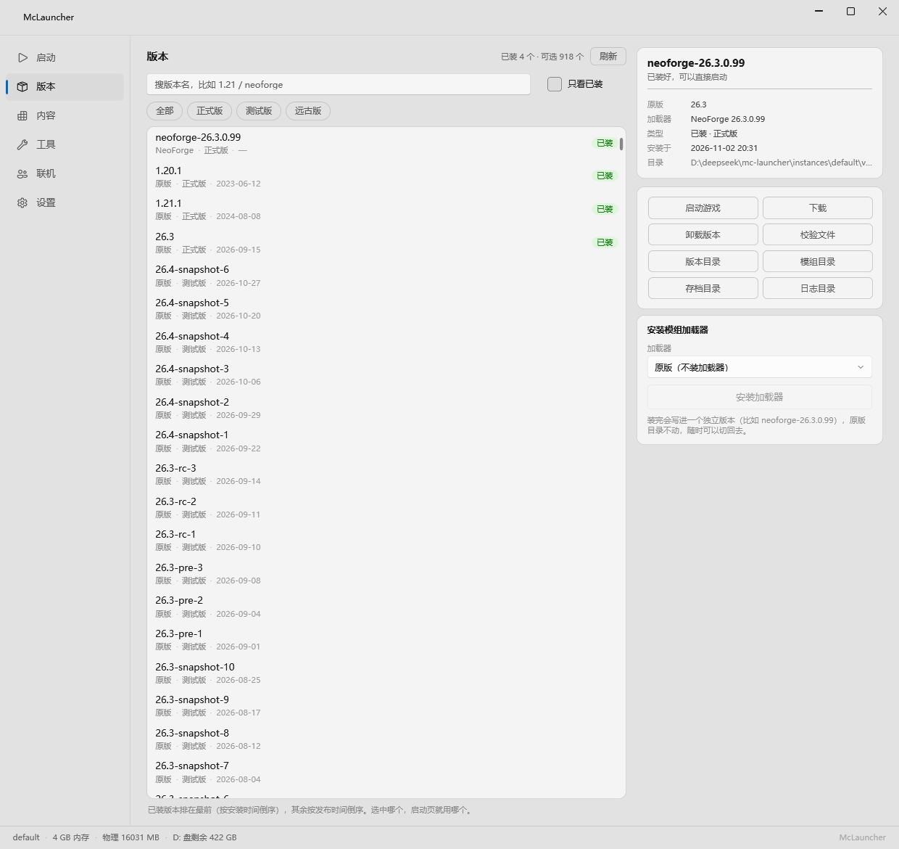
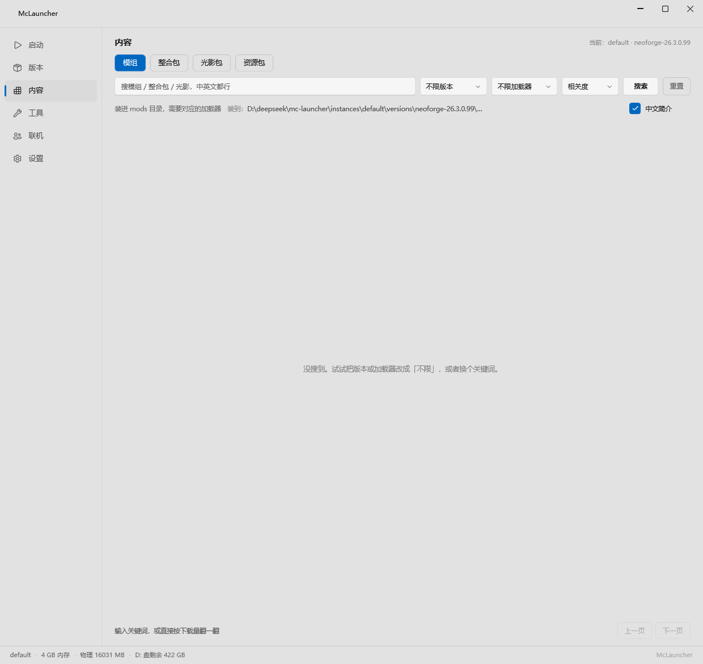
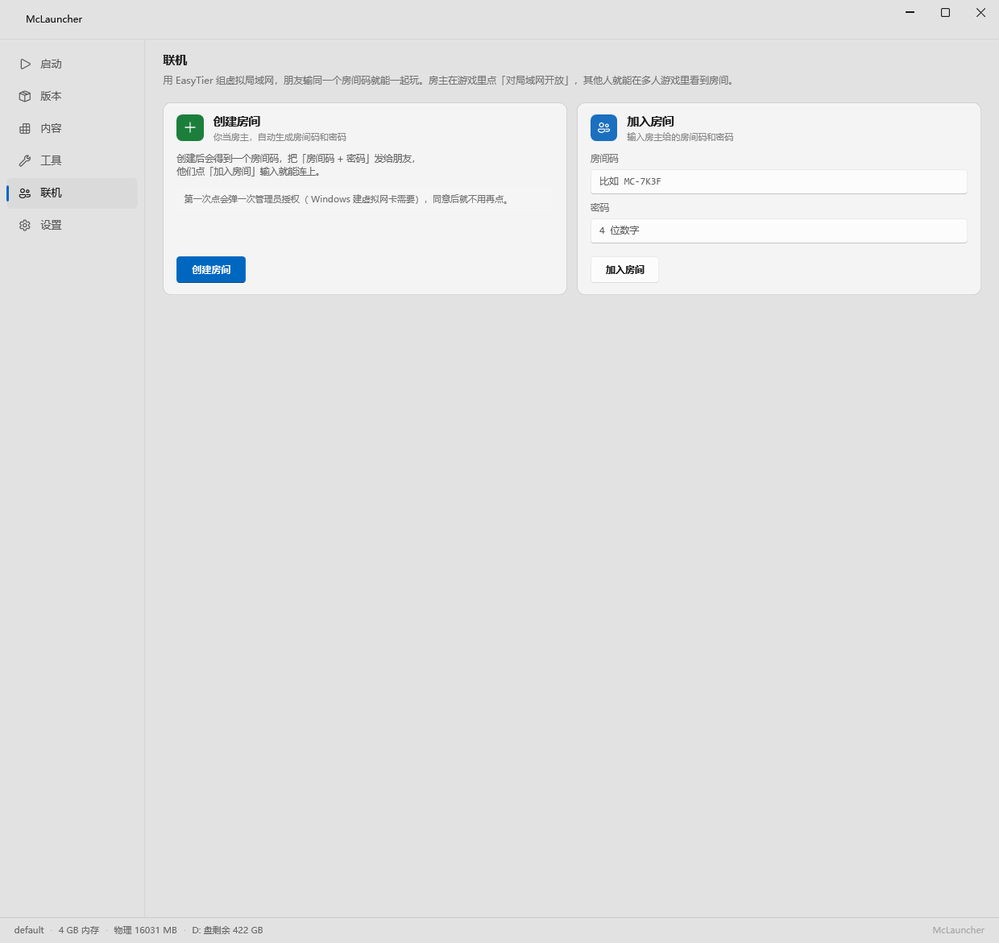
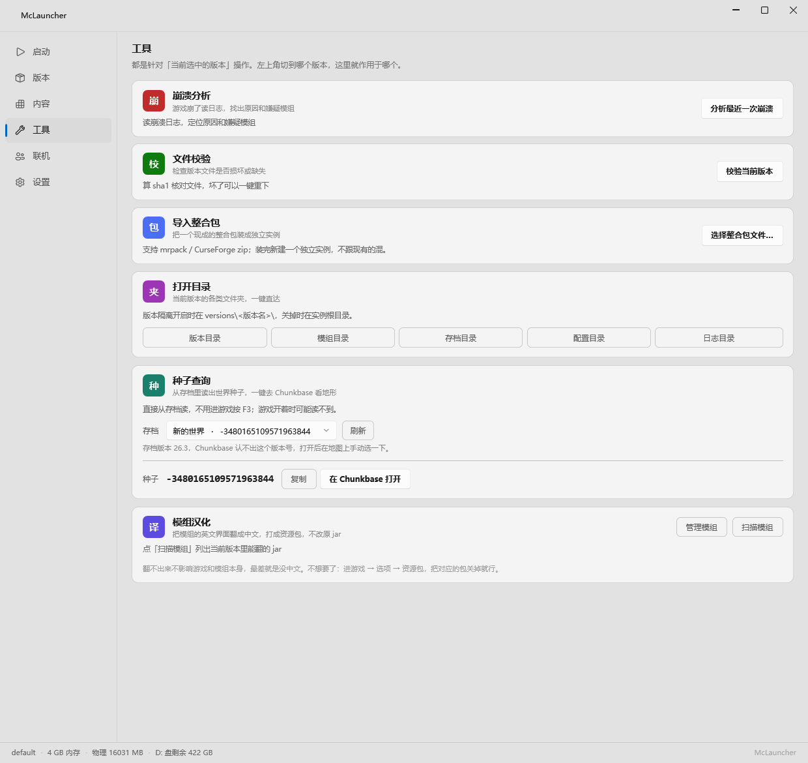
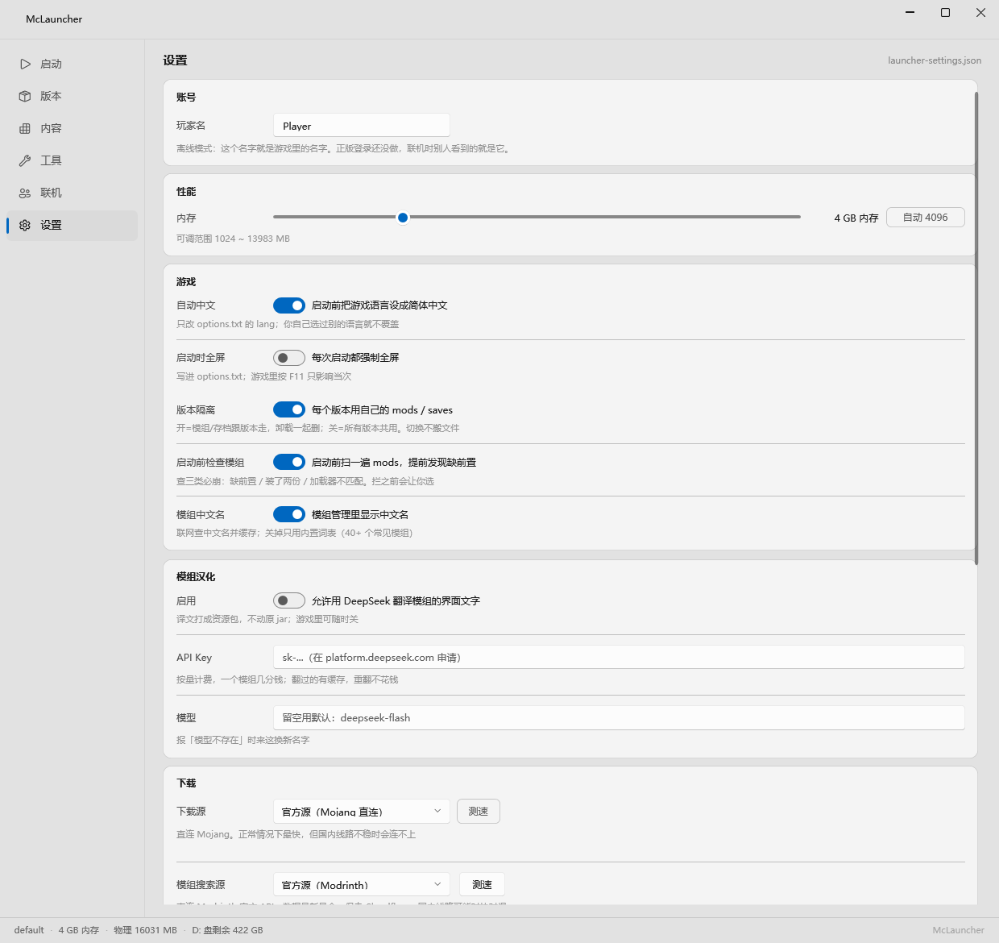

# McLauncher

一个用 C# + WPF 写的 Minecraft Java 版启动器，只支持 Windows。

我没打算做成 PCL / HMCL 的替代品，只是想把日常用得到的那些功能做成自己能控制的形状：安装、启动、装模组、看日志，不夹带广告和捆绑。



## 功能

**游戏安装与启动**

- 原版全版本下载与启动，支持快照
- Forge / NeoForge / Fabric 一键安装（版本列表从 maven 元数据拉，不爬网页）
- 下载源可切：官方源 / BMCLAPI 镜像，切换后自动测速
- 多实例隔离：每个实例独立的 `mods` / `saves` / 配置，共享 `libraries` / `assets` / `runtime`
- Java 运行时按需自动下载，也可指定本地 JDK
- 内存、GC、自定义 JVM 参数

**内容**

- 直接搜 Modrinth 装模组、整合包、光影包、资源包，自动解析前置依赖
- 导入本地整合包（`.mrpack`、CurseForge `.zip`、手动打包的懒人包）
- 模组管理：中文名、图标、启停开关
- 启动前模组预检：查缺前置、重复安装、加载器不匹配
- 模组界面汉化：用 DeepSeek 翻译，译文打成资源包，不动原 jar

**账号**

- 离线模式（UUID 由名字算 MD5 得出，换启动器不会丢存档）
- 微软正版登录，refresh token 自动续期，不用反复登
- 可导入官方启动器里已登录的令牌

**其他**

- 崩溃日志分析：按规则定位原因，也可以接 AI 再分析一层
- 文件完整性校验，坏了能单独重下
- 种子查询：直接从存档文件读，不用进游戏按 F3
- 联机：基于 EasyTier 组虚拟局域网（需自行下载组件，见下文）

## 截图

| 版本列表 | 内容搜索 |
|---|---|
|  |  |

| 联机 | 工具 |
|---|---|
|  |  |



## 环境要求

- Windows 10 / 11（x64）
- [.NET 8 SDK](https://dotnet.microsoft.com/download/dotnet/8.0)（自己编译才需要，用现成 exe 不用）

## 构建

```powershell
git clone <仓库地址>
cd mc-launcher
dotnet build McLauncher.sln -c Release
```

打包成单个 exe：

```powershell
dotnet publish src/McLauncher.App/McLauncher.App.csproj `
  -c Release -r win-x64 --self-contained true `
  -p:PublishSingleFile=true -p:IncludeNativeLibrariesForSelfExtract=true `
  -o dist
```

产物在 `dist\`，约 170 MB（自包含运行时，目标机器不用装 .NET）。

## 联机组件（可选）

联机功能依赖 [EasyTier](https://github.com/EasyTier/EasyTier)（LGPL-3.0）。这 34 MB 二进制没有放进仓库，需要自己下：

1. 从 [EasyTier Releases](https://github.com/EasyTier/EasyTier/releases) 下载 Windows 版
2. 把下面这些文件放到 `vendor/easytier/`：

```
vendor/easytier/
├── easytier-core.exe
├── easytier-cli.exe
├── wintun.dll
├── Packet.dll
├── WinDivert64.sys
└── LICENSE-LGPL-3.0.txt
```

不放也能编译，只是联机页用不了。

## 目录结构

```
src/
├── McLauncher.App/     WPF 界面层（窗口、页面、视图模型）
└── McLauncher.Core/    无 UI 依赖的核心逻辑
    ├── Auth/           离线 / 微软账号
    ├── Launcher/       路径、设置、崩溃分析
    ├── Modrinth/       内容搜索与下载
    ├── Mods/           模组管理、预检、中文名
    └── Translation/    模组汉化
```

运行时数据（实例、账号、日志）在 exe 同级的 `instances\` 和 `launcher\` 下，都不入库。

## 第三方

| 组件 | 用途 | 协议 |
|---|---|---|
| [CmlLib.Core](https://github.com/CmlLib/CmlLib.Core) | Minecraft 安装与启动 | MIT |
| [WPF-UI](https://github.com/lepoco/wpfui) | Fluent 风格控件 | MIT |
| [CommunityToolkit.Mvvm](https://github.com/CommunityToolkit/dotnet) | MVVM | MIT |
| [EasyTier](https://github.com/EasyTier/EasyTier) | 联机组网（可选） | LGPL-3.0 |

## 已知限制

- 只支持 Windows，WPF 的限制
- 只做了 Modrinth，没接 CurseForge（它的 API 不给个人开发者发 key）
- 种子查询是从存档文件反解，不是查在线地图，所以只能查自己去过的地方
- 界面只有浅色

## 免责声明

个人项目，与 Mojang Studios / Microsoft 没有关联。Minecraft 是 Mojang 的商标。

本启动器不内置游戏本体，也不绕过正版验证，请使用自己合法拥有的账号。

## 许可证

暂未确定，后续补上。在此之前保留所有权利。
